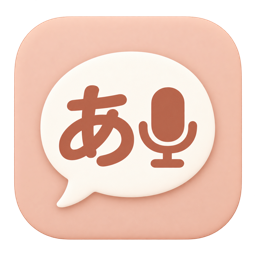
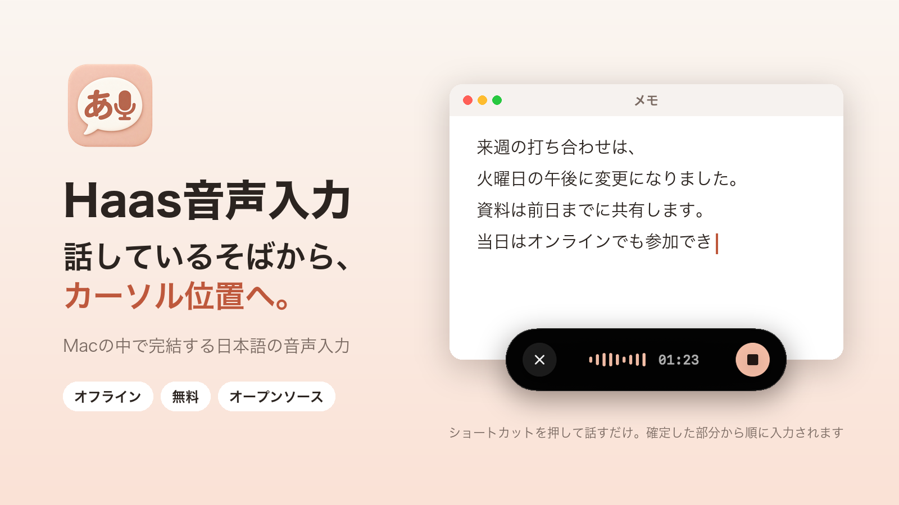
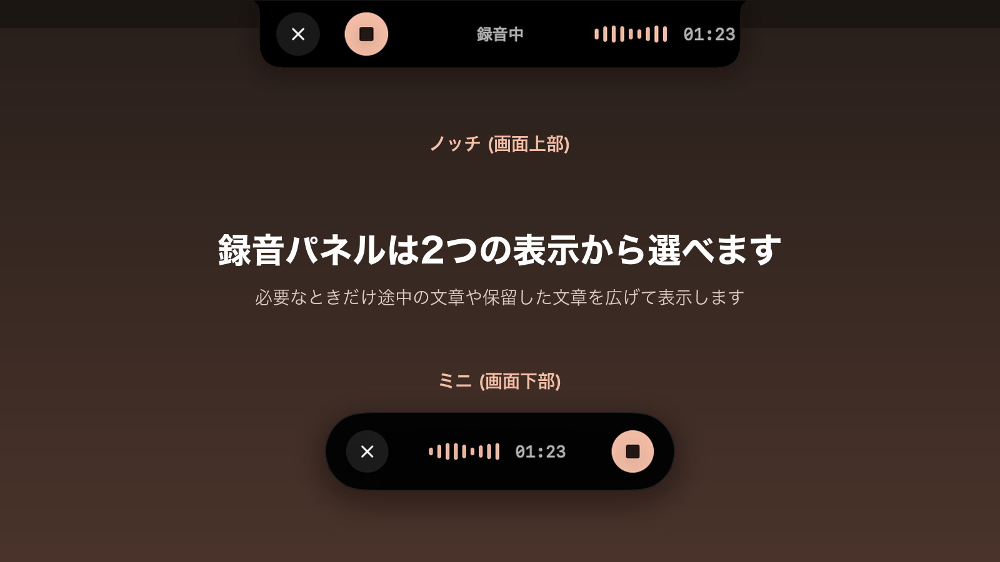

<p align="center">
  
</p>

<h1 align="center">Haas音声入力</h1>

<p align="center">話しているそばから、カーソル位置へ。Macの中で完結する日本語の音声入力アプリです。</p>

<p align="center">
  <a href="https://github.com/masatatsu8/haas-input/releases/latest"></a>
  
  
  <a href="LICENSE"></a>
</p>

<p align="center">
  <a href="https://github.com/masatatsu8/haas-input/releases/latest"><strong>ダウンロード</strong></a> ·
  <a href="#インストール">インストール</a> ·
  <a href="#使い方">使い方</a> ·
  <a href="#ソースからビルドする">ビルド</a>
</p>

<p align="center">
  
</p>

日本語の音声をこのMacの中で認識し、カーソル位置へ入力するmacOSアプリです。認識には日本語音声認識モデル[Haas-ja](https://huggingface.co/third-intelligence/Haas-ja-v1.0)を使います。録音中に確定した区間から順に入力するため、話し終える前から文字が入り始めます。

- 認識はすべて端末内で行い、音声や文章を外部へ送信しません。
- モデルと推論エンジンはアプリに同梱しています。初回起動時のダウンロードはありません。
- Appleの端末内モデルで「、」「。」「？」を補います。話の途中で間が空いたときは、続きの言葉を見てから「。」を付けるか決めます。
- 入力した直後なら、ホットキー1つで直して入れ直せます。直した語は、選んで辞書に覚えさせられます。
- 正式表記と読みを登録する辞書で、固有名詞の認識を補えます。読みで照合できた誤認識も、登録した表記にそろえます。
- 「記録」画面で、話した時間・文字数・回数を1年分の草で振り返れます。
- 入力先を確認できないときは文章を保留し、あとからコピー・再入力できます。

## 動作環境

- Apple Silicon (M1以降) のMac
- macOS 15以降
- 空き容量 約1GB (アプリ本体。履歴と録音は別に保存します)

句読点を端末内モデルで補うには、macOS 26以降と、利用可能なApple Intelligenceが必要です。使えないMacでは、明確な文末にだけ「。」「？」を補います。

## インストール

1. [リリースページ](https://github.com/masatatsu8/haas-input/releases/latest)から`HaasInput-<バージョン>-arm64.zip`をダウンロードし、展開します。
2. `Haas音声入力.app`を「アプリケーション」フォルダへ移します。
3. アプリを開きます。

Appleの公証を受けていない配布版を初めて開くと、開発元を確認できないという警告が出て起動が止まります。その場合は「システム設定」の「プライバシーとセキュリティ」を開き、Haas音声入力の「このまま開く」を選んでください。macOSの本人確認のあと、アプリを開けます。

## 初回の設定

### 権限を許可する

ホーム画面に、必要な権限と現在の状態が表示されます。

| 権限 | 用途 |
|---|---|
| マイク | 音声を録音して認識します |
| アクセシビリティ | ショートカットの検出と、ほかのアプリへの文字入力に使います |

アクセシビリティは「システム設定」の「プライバシーとセキュリティ」→「アクセシビリティ」で、Haas音声入力をオンにします。許可を変えたらアプリへ戻ってください。macOSのバージョンによってはこの項目が見当たらないことがあります。その場合はターミナルで次を実行すると、許可の一覧を直接開けます。

```sh
open "x-apple.systempreferences:com.apple.preference.security?Privacy_Accessibility"
```

アプリを更新したあと、アクセシビリティがオンなのに許可されていない表示になることがあります。アプリの署名が変わったためです。一覧からHaas音声入力を「−」で削除し、「+」で新しいアプリを追加し直してから、アプリを再起動してください。

### 録音ショートカットを登録する

初回は録音ショートカットが未登録です。「設定」の「録音ショートカット」で、使いたいキーを登録します。キーの組み合わせのほか、Fnなどの修飾キーだけでも登録できます。

録音の操作は次から選べます。既定は「短押しと長押しを併用」です。

| 操作 | 動き |
|---|---|
| 短押しと長押しを併用 | 長押しすると離すまで録音します。短く押すと録音を始め、もう一度押すと止めます |
| 押している間だけ録音 | キーを押している間だけ録音します |
| 押すたびに開始・停止 | 押すたびに録音の開始と停止を切り替えます |
| 2回押して開始・停止 | 2回続けて押すと開始・停止します |

## 使い方

### 音声で入力する

1. 文字を入れたいアプリの入力欄をクリックし、カーソルを置きます。
2. 選んだ操作に合わせて録音ショートカットを押し、話します。「2回押して開始・停止」では、開始と停止のどちらも2回続けて押します。
3. 確定した区間から、カーソル位置へ順に入力されます。話し終えたら、選んだ操作に合わせて録音を止めます。

録音中は小さな録音パネルが表示されます。パネルの位置は「設定」の「表示」で、画面下部の「ミニ」と画面上部の「ノッチ」から選べます。途中の認識結果を表示するかどうかも、ここで切り替えられます。

<p align="center">
  
</p>

録音を取り消すには、録音パネルが出ている間にEscを2回押します。

### 入力した文を直す

誤認識に気づいたら、「設定」の「ほかの操作」で割り当てた「直前の入力を直す」のホットキーを押します。直前の録音で入力した文が小さな窓に出るので、直して「直して入力」(⌘Enter) を押します。

- 入力の直後で、そのあと入力先を操作していなければ、入れた文を直した文に置き換えます。それ以外のときは入力先に触れず、直した文をクリップボードに入れます。
- ターミナルなど中身を読めない入力先では、「前の◯文字を消して入れ直す」と表示し、押したときだけ置き換えます。長い文や複数行の文は、置き換えずにコピーします。
- 直した前後の違いから辞書の候補が出ます。チェックを付けた語だけを辞書に登録するので、同じ誤認識が減っていきます。

### 入力できなかった文章

入力先のアプリを確認できないときは、誤った場所への入力を防ぐため送信を止めます。パスワード欄などでセキュア入力が有効になっているときも同様です。保留した文章は録音パネルに表示され、コピーや入力の再開ができます。

過去の録音で入力を確認できなかった文章は、「履歴」の「入力確認待ち」に残ります。自動では再送しません。必要な文章をコピーして入力し、終わったら「確認済み」にしてください。

### 5つの画面

| 画面 | できること |
|---|---|
| ホーム | 録音の開始・停止、モデルの準備状態、権限の確認 |
| 記録 | 今日と1年分の利用状況 (話した時間・文字数・回数) |
| 履歴 | 認識した文章と録音の再生、コピー、CSV出力、入力確認待ちの操作 |
| 辞書 | Haas辞書と置換ルールの登録、辞書ファイルの読み込み・書き出し |
| 設定 | ショートカット、マイク、句読点、録音パネル、クリップボード、履歴の保存期間、ログイン時の起動 |

### 辞書で認識を補う

「辞書」のHaas辞書に、正式表記と読み・別表記を登録します。認識時にその語を出やすくし、結果を正式表記へそろえます。読みで照合できた語は、別の表記で認識された場合も登録した表記に置き換えます。読みが複数あるときはカンマで区切ります。「組織」「製品」「人名」「その他」の種類は整理用で、認識には使いません。

置換ルールは、認識後の文章に含まれる語を別の語へ置き換える機能です。Haas辞書とは別に働きます。辞書と置換ルールの変更は、次の録音から反映されます。

### 句読点

「設定」の「句読点」で補い方を選びます。

| 設定 | 動き |
|---|---|
| 速度優先 | 追加のAIを使わず、明確な文末にだけ「。」または「？」を補います |
| 自然さ優先 (既定) | 利用できる場合はAppleの端末内モデルで「、」「。」「？」を補います |
| 誤字も修正 | 利用できる場合はAppleの端末内モデルで「、」「。」「？」を補い、明らかな誤変換も直します |

- 話の途中で間が空いて区切れたときは、次に話し始めた言葉を見てから「。」を付けるか決めます。「〜です」のあとに「けど」と続けても、「〜です。けど」にはなりません。
- 端末内モデルの結果を使えない区切り (モデルが使えない、時間内に返らない、元の文を変えすぎている など) には、速度優先と同じ規則で「。」「？」を補います。

### 保存されるデータ

履歴、録音ファイル、置換ルール、入力確認待ちは、このMacの次の場所に保存します。

```text
~/Library/Application Support/com.tatsumi.VoiceInkHaas/
```

Haas辞書はアプリの設定 (`com.tatsumi.VoiceInkHaas`のUserDefaults) に保存します。別のMacへ移すときは、「辞書」の書き出しと読み込みを使ってください。

新しくインストールした場合の既定では、7日を過ぎた履歴と録音を録音終了後に自動で削除します。0.1.0以前から使っていて、この設定を変えていない場合は、従来どおり自動で削除しない設定を引き継ぎます。期間の変更や自動削除の停止は、「設定」の「履歴の保存期間」で行えます。削除した録音はゴミ箱へ移します。入力確認待ちの文章は、確認が終わるまで残ります。

bundle IDの`com.tatsumi.VoiceInkHaas`は、前身の「VoiceInk Haas」のデータを引き継ぐために維持しています。

## ソースからビルドする

### 必要なもの

- Apple SiliconのMac、macOS 15以降
- macOS 26以降のSDKを含むXcode
- [XcodeGen](https://github.com/yonaskolb/XcodeGen) 2.44.1以降
- Python 3、Git

### ビルド

リポジトリのルートで実行します。

```sh
make build
```

初回は、Swiftの依存ライブラリ、推論エンジン、モデルをインターネットから取得します (合計 約700MB)。完成したアプリは次の場所に作成されます。

```text
.haas-build/dedicated-app-candidate/Haas音声入力.app
```

ビルド処理はアプリを起動せず、ほかの場所へ自動で配置もしません。

### ビルド時に取得するファイル

`scripts/prepare-haas-runtime.py`が次のファイルを取得します。取得元は特定のrevisionに固定し、SHA-256が一致しない場合はビルドを止めます。取得したファイルは`.local-dependencies/haas-runtime/`に置き、アプリの`Contents/Resources/Haas/`へ同梱します。

| ファイル | 取得元 |
|---|---|
| 推論エンジン speech.cpp v0.9.4 | [nyosegawa/speech.cpp](https://github.com/nyosegawa/speech.cpp/releases/tag/v0.9.4) のリリース |
| 認識モデル `Haas-616M-ja-v1.0-Q8_0.gguf` | [sakasegawa/Haas-ja-v1.0-GGUF](https://huggingface.co/sakasegawa/Haas-ja-v1.0-GGUF) |
| 発話区間の検出 `silero-vad-309K-v6.2-F32.gguf` | [sakasegawa/silero-vad-GGUF](https://huggingface.co/sakasegawa/silero-vad-GGUF) |
| 上記と、speech.cppに組み込まれるggml・cpp-httplib・miniaudioのライセンス文 | 各取得元の`LICENSE` |

Swiftの依存ライブラリ (Swift Atomics、MediaRemoteAdapter) のrevisionは`project.yml`で固定しています。

### ビルドの設定

Command Line Toolsが選ばれていて`DEVELOPER_DIR`が未指定の場合、ビルドとテストのスクリプトは`/Applications/Xcode.app`を使います。システムの`xcode-select`設定は変更しません。別のXcodeを使う場合は、そのビルドに限って指定します。

```sh
DEVELOPER_DIR=/Applications/Xcode.app/Contents/Developer make build
```

| 環境変数 | 用途 |
|---|---|
| `HAAS_OUTPUT_ROOT` | アプリの出力先 |
| `HAAS_BUILD_CONFIGURATION` | 既定は`Release`。開発時は`Debug`も指定できます |
| `HAAS_CODESIGN_IDENTITY` | 署名ID。既定は`-` (ad-hoc署名) |
| `HAAS_BUNDLE_MODELS` | `1` (既定) でモデルを同梱、`0`で同梱しません |

署名IDを変えると、アクセシビリティ権限の再登録が必要になる場合があります。

### テスト

```sh
make test
```

本番と異なるbundle IDのTestHostで実行します。TestHostはモデルの準備や録音を始めません。移行の検証には合成データを使い、実際の辞書・履歴は使いません。

### Xcodeプロジェクト

Xcodeプロジェクトの正本は`project.yml`です。生成済みのprojectは直接編集せず、`project.yml`を変えてから再生成します。

```sh
make project
```

`make clean`はビルドとTestHostの中間生成物だけを削除します。モデルの取得キャッシュ、完成したアプリ、利用者の保存データは残します。

## ライセンス

アプリのソースコードは[GNU General Public License v3.0](LICENSE)で公開しています。[VoiceInk](https://github.com/Beingpax/VoiceInk)のコードを再利用しています。同梱するモデル・推論エンジン・ライブラリのライセンスは[LICENSE.md](LICENSE.md)にまとめています。
